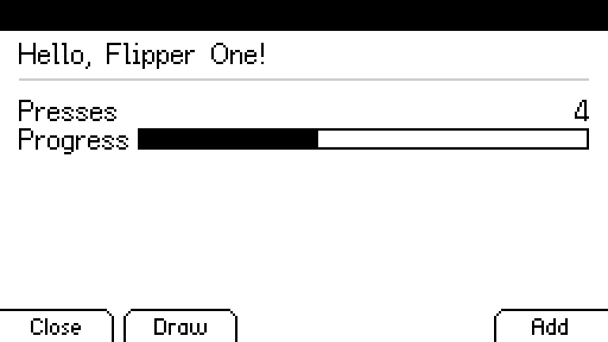
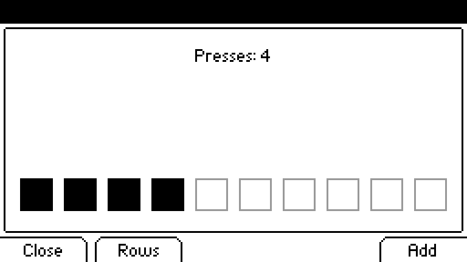

# Writing an app

An app is an ordinary Wayland client. flipctl runs a headless compositor, gives the
app an output sized to what it draws and a workspace of its own, reads its frames
and puts them on the panel. Nothing describes the app's screen to flipctl: the app
owns every pixel of its surface, and what keeps it looking like the device is that
it draws with flipctl's own widgets.

## Hello world

The smallest whole app: a greeting, a counter Ok or Add raises, a gauge that fills as
it goes, the real status bar, and Back or Close to leave. In Rust it has a second
page, under Draw, that it paints itself. Every rule behind it is in the sections that
follow; this is the shape to start from.

### In Rust, as a bundle

[`apps/hello`](../apps/hello) is the app, and the one to copy to start your own. A
Rust app is a crate of its own under `apps/`, beside the others, since it takes the
framework by path:

| File | What it does |
|---|---|
| [`app.toml`](../apps/hello/app.toml) | The manifest: the name in the Apps list, and the program, which the bundler turns into the bundle's entry point. |
| [`Cargo.toml`](../apps/hello/Cargo.toml) | A `[workspace]` of its own, so cargo does not take the crate for a member of the one around it; `flipctl-app` as a dependency and as a build dependency; Slint with the Wayland backend and the software renderer. |
| [`build.rs`](../apps/hello/build.rs) | One line: compiles the page with the widgets under `@flipctl`, the window under `@app` and the tokens under `@theme`. |
| [`ui/app.slint`](../apps/hello/ui/app.slint) | The page. It inherits `Shell`, which is the window, forwards the keys to a `keyed` callback Rust can bind, and shows one of two bodies: `DetailBody` for the rows, `CanvasBody` for the picture. Both draw the status bar and the soft keys; the page only passes properties through. |
| [`src/main.rs`](../apps/hello/src/main.rs) | Fills the properties in and answers the keys. `rows()` builds the `DetailRow`s, `picture()` paints the canvas, `draw()` puts the current page up, and `main()` starts the status bar's 1s poll and binds the keys. |

A row's `kind` says what it is: 0 a label and a value, 1 a rule, 2 a gauge, 3 a line
of text (the comment on `DetailRow` in `detail.slint` lists the rest). A soft key's label is its slot in `buttons`, left to right,
and `pressed_slot` draws the one being held, which `Key::soft_slot` gives.

Drawing the picture yourself is where an app can go wrong without noticing, so
`picture()` in `main.rs` keeps to these rules:

- **The picture is the whole panel.** `Surface::panel()` is 256x144, and
  `CanvasBody` stretches whatever it gets to the panel, so a smaller surface comes out
  scaled. The status bar covers the top `metric::STATUS_BAR_H` (13px) and the soft keys
  the bottom `metric::BUTTON_H` (14px), so content goes between them.
- **Only token colours.** The panel is 8-bit grey and the design uses a fixed set of
  greys. Paint with `theme::color::*` (`BLACK`, `WHITE`, `STATUS_DIM`, ...), never
  with a `Gray8` of your own. There is no alpha and no antialiasing: every pixel is one
  token.
- **Corners come from the surface.** `round_frame` and `round_rect` cut the panel's
  45-degree chamfer. Do not plot rounded corners of your own.
- **Coordinates are whole pixels and they clip.** Drawing partly off the surface
  is safe, so a scrolling or moving shape needs no bounds checks.
- **Text goes over the picture, not into it.** A `CanvasText` is drawn by Slint in
  the panel's fonts at 16px: `x`, `y` is where it goes, `align` -1 starts it at `x`,
  0 centres it on `x` and 1 ends it at `x`, and `font` picks the title face (0) or a
  row's (1, 2). Use `Surface::text` with `font::TITLE` only when text has to be part of
  the bitmap, and measure it with `font::tw`.
- **A change is a new picture.** Paint a fresh surface and set `picture` again. The
  panel has no partial update, a picture is 110KB, and a few a second cost nothing; for
  animation, repaint from a `slint::Timer`.

Build it once on the host to make `Cargo.lock`, which the bundler builds against with
`--locked`, then bundle it and push it:

    (cd apps/hello && cargo build --release)
    scripts/gen-third-party-licenses.sh
    tools/appimage/build.sh apps/hello
    FLIPPER_HOST=<device> ./build_deploy.sh --apps

`--apps` on its own copies `target/appimage/*.AppImage` to `~/Apps` and builds nothing
else. That is every bundle there, however old, over what the device has; to send one,
copy it over yourself:

    scp target/appimage/hello-aarch64.fap.AppImage user@<device>:Apps/

Hello is then in the Apps list, with the bundler's own icon until the app has
one. Commit `Cargo.lock` and `THIRD-PARTY-LICENSES.md` with the app.

To check pixels without a device, render the page headlessly in a test, as
`apps/radio` does: `FlipperSlintPlatform::install()` and `render_frame` give the
256x144 grey bytes the panel would get, to save as a PNG and to test against the
tokens.

### As a script

The same app as one file, with nothing to build, and with the rows page only. The
script says what the rows are and what its keys do; the window, the page, scrolling,
the press shown on a soft key and Escape closing come from the `flipctl` module its
runtime carries. In Python, as `hello.fap.py`:

    #!/usr/bin/env python3
    # /// flipctl
    # name = "Hello"
    # status = true
    # ///

    import flipctl

    presses = 0

    def rows():
        return [
            flipctl.text("Hello, Flipper One!"),
            flipctl.rule(),
            flipctl.pair("Presses", str(presses)),
            flipctl.gauge("Progress", "", min(100, presses * 10)),
        ]

    app = flipctl.Detail(rows=rows, buttons=["Close", "", "", "", "Add"], fit_gauges=True)

    @app.on_key
    def _(key):
        global presses
        if key in (flipctl.Key.OK, flipctl.Key.RUN):
            presses += 1
            return True
        return False

    app.run()

In JavaScript, as `hello.fap.js`:

    #!/usr/bin/env node
    // /// flipctl
    // name = "Hello"
    // status = true
    // ///

    "use strict";

    const flipctl = require("flipctl");

    let presses = 0;

    const app = flipctl.detail({
        rows: () => [
            flipctl.text("Hello, Flipper One!"),
            flipctl.rule(),
            flipctl.pair("Presses", String(presses)),
            flipctl.gauge("Progress", "", Math.min(100, presses * 10)),
        ],
        buttons: ["Close", "", "", "", "Add"],
        fitGauges: true,
    });

    app.onKey((key) => {
        if (key === flipctl.Key.Ok || key === flipctl.Key.Run) {
            presses += 1;
            return true;
        }
        return false;
    });

    app.run();

A handler gets each key as it goes down and returns true for one it used; the rest
keep their defaults, Escape closing and Up and Down scrolling. After every key the
page is drawn again from `rows`. Back never reaches an app: flipctl takes it and sends
the app to the background.

There are three views, and an app may have several, each shown with `show()` in the
one window:

| View | Python | JavaScript | Shows |
|---|---|---|---|
| Rows | `flipctl.Detail(rows=...)` | `flipctl.detail({rows})` | `pair`, `rule`, `gauge`, `text`, `choice`, `heading` |
| Menu | `flipctl.Menu(items=...)` | `flipctl.menu({items})` | `item` rows, a cursor that Up and Down move, and `selected` |
| Log | `flipctl.Log(lines=...)` | `flipctl.log({lines})` | lines under a title, scrolling |

`buttons` is a list or a function returning one, `on_close` (`onClose`) runs before the
app leaves and may be awaited, and `run(every=1)` (`run({every: 1})`) draws on a clock
for an app that only reads. An app with something to wait on hands Python's `run` a
coroutine and calls `app.redraw()` when it has news; in JavaScript the usual timers and
promises run beside the window.

`status = true` has flipctl paint the real status bar into the frame, so a script
reads no sysfs for it. Copy the file into `~/Apps` on the device and it is listed; it
runs once the Python or JavaScript Runtime is installed from the App Manager, which
offers the runtime itself when you install a script from the catalogue.

## Where an app lives

An app is delivered as one file in the user's `Apps` folder, either an AppImage or a
script:

    /home/user/Apps/radio-aarch64.fap.AppImage       Internet radio, at the top of the list
    /home/user/Apps/stations.fap.py                  a script, run through its runtime
    /home/user/Apps/Network/nmap-aarch64.fap.AppImage inside the Network folder

`/home` is the one subvolume every profile shares, so the folder survives a factory
reset and serves every profile. A folder is a group: the Apps list shows how many
apps are inside, Ok walks into it, Back comes back out, and the list opens at the top
each time. Nothing is installed to run an app; the file is the whole of it.

What makes a file ours is a manifest: `app.toml` at the root of a bundle's squashfs,
or a `# /// flipctl` block in a script's head. A file with neither is not listed, and
the log says so once (`bundles        Foo: not a flipctl app, skipped`). flipctl reads
the manifest and the icon out of a bundle without running it, keeps them under
`~/.cache/flipctl/bundles/<key>/`, and does not open an unchanged file again; a script
is read as text every scan, which costs one `read` of its first 8KB.

Neither kind is ever executed to find out what it is. The folder is where a person
drops anything, and the scan runs in a unit that can reach the GPIO and the USB bus.

## The manifest

`app.toml`, in the source directory under `apps/` and copied into the bundle:

| Field | What |
|---|---|
| `name` | What the Apps menu shows. |
| `wayland` | The command. In the source it is what the bundler turns into the bundle's entry point; in the bundle it is `./AppRun`, and flipctl only needs it non-empty. |
| `icon` | A PNG beside the manifest, drawn on the app's row: 14px wide, the alpha is the shape, and a strip of 14px frames animates while the row is selected, like the menu's own icons. Without one the bundler puts in its own. |
| `size` | `"320x200"` for a program that insists on drawing at its own size. The output is made that shape and the frame is scaled to the panel. |
| `apt` | Debian packages the app needs from the device. flipctl checks them with dpkg before the first launch and offers the install. |
| `audio` | Links the PipeWire sockets into the app's runtime directory and pins the panel's sink. |
| `status` | flipctl paints its own status strip over the app's frame, for a program that cannot draw one. An app on the framework draws the real bar itself and leaves this off. |
| `rotate` | `"left"` or `"right"` for a portrait app. |
| `env` | Extra environment, one `"KEY=value"` per entry. Applied last, so it overrides what the launch sets. |
| `runtime` | The runtime this app is run through, e.g. `"py"`. A bundle declaring the same word in `provides` is the launcher that runs it. A script defaults to the runtime its extension implies. An app whose runtime nothing provides is listed and refused with a sentence naming it. |
| `provides` | The runtime word a launcher bundle answers to, e.g. `"py"`. `apps/python-runtime` is the worked example. |
| `folder` | The folder under `~/Apps` a bundle is filed in, e.g. `"Runtimes"`. flipctl never reads it: `--apps` and the catalogue put the file there, and a script is filed by where it sits under `apps/`. |

## A script is an app

A script in the folder carries its manifest in its own head, in the block shape PEP 723
defines, written in the language's own comments. A `.py` puts it beside PEP 723's own
block naming what it needs installed:

    #!/usr/bin/env python3
    # /// script
    # dependencies = ["httpx"]
    # ///
    # /// flipctl
    # name = "Stations"
    # icon = "stations.png"
    # audio = true
    # ///
    import flipctl

A `.js` is the same block behind `//`:

    #!/usr/bin/env node
    // /// flipctl
    // name = "Uptime"
    // status = true
    // ///

Every manifest field means what it means for a bundle. Two are filled in when the
block leaves them out: `runtime`, from the extension, and `wayland`, from the file's
own name, because a script names no command of its own. An icon is a PNG beside it.

`apps/ping.fap.py` and `apps/uptime.fap.js` are the worked examples, and each is the
whole app: a file in the tree beside the bundle directories, pushed to `~/Apps` as it
stands by `--apps`, with nothing to build. `apps/Test Tools/network-leds.fap.py` is the
menu. Each draws with the panel's own widgets through the `flipctl` module its runtime
carries, which compiles the pages in `crates/flipctl-app/ui/pages.slint` at run time.
Both runtimes run the device's own interpreter, `python3` or `nodejs` from their `apt`,
and carry only the drawing stack.

Build rows with the module's constructors rather than as plain dicts. A Python row
handed to Slint must carry every field of its struct: one left out reaches the body as
nothing rather than a default, and the interpreter panics at launch. The constructors
fill them all.

What actually starts it is the launcher bundle whose `provides` matches its `runtime`,
with the script as its argument, in a working directory of the script's own under
`~/.local/share/flipctl/apps/<key>/`. With no such launcher installed the script is
still listed, and starting it says which runtime is missing.

## How a bundle runs

flipctl runs the file itself, from a writable directory of the app's own under
`~/.local/share/flipctl/apps/<key>/`, with `FLIPCTL_HOSTED=1` in the environment
alongside the Wayland display and the rest. The AppImage runtime mounts the squashfs
over FUSE and runs `AppRun`, which puts `usr/bin` and `usr/lib/aarch64-linux-gnu`
from the bundle ahead of the device's own and execs the program. A device without
`fuse3` still works: flipctl notices there is no `fusermount3`, sets
`APPIMAGE_EXTRACT_AND_RUN=1`, and the runtime unpacks the image into `/tmp` per launch
instead, slower and said in the log.

Started anywhere else, `AppRun` finds `FLIPCTL_HOSTED` unset and hands the file over:

    flipctl open /home/user/Apps/radio-aarch64.fap.AppImage

connects to the running flipctl's socket at `$XDG_RUNTIME_DIR/flipctl.sock`, one line
each way, and flipctl lists the bundle if it is new, starts it, or brings it to the
front if it is already on the panel. So a double-click in the desktop's file manager
puts the app on the panel rather than on the HDMI screen. The exit status says what
happened: 0 on the panel, 1 refused (`not a flipctl app`, `cannot host apps`), 2
nothing listening.

A hosted app runs with the unit's groups and device classes: GPIO, SPI, I2C, USB and
USB serial are open to it (`systemd/README.md` lists what the image ships for that).

## Bundling

    tools/appimage/build.sh apps/radio        target/appimage/radio-aarch64.fap.AppImage
    tools/appimage/build.sh --all
    tools/appimage/build.sh --check target/appimage/radio-aarch64.fap.AppImage
    ./build_deploy.sh --cross --panel --apps  push what was built to ~/Apps

The build runs on the x86_64 host and nothing aarch64 executes there: the program is
cross-built in the `flipctl-cross` container, `tools/appimage/bundle.py` lays out the
AppDir in the `flipctl-bundle` container, and appimagetool packs it with zstd behind
the aarch64 runtime, both pinned by sha256 in `tools/appimage/tools.lock`. The
program's link surface is checked on the way: a framework app needs `libc`, `libm`
and `libgcc_s` and nothing else, and anything more fails the build by name.
`SOURCE_DATE_EPOCH` is the commit's time, so two builds of one tree give one hash.

An app can carry programs of its own as well as name them in `apt`, from two
places, each pinned by checksum in a lock file beside the manifest:

| File | What | Unpacked by |
|---|---|---|
| `deb.lock` | Debian packages, as `url sha256 size` lines from `apt-get download --print-uris` | `tools/appimage/fetch-debs.sh` |
| `release.lock` | files from upstream release pages, as `path url sha256` lines; a tarball gives up the member named like `path` | `tools/appimage/fetch-release.sh` |

Both unpack into `<app>/runtime`, laid out as a `/usr`, at build time. A crate's
staging copies that over the AppDir's root, so a program lands in the `usr/bin`
AppRun puts first on PATH and a library in the directory it puts first on
`LD_LIBRARY_PATH`; an app with an AppRun of its own (`apps/doom`) points at it
itself. glibc is never carried: a program cannot bring its own loader.

What to carry is a size question. The radio's `mpv` stays in `apt`: it is in the
Desktop image, and bundling it would drag ffmpeg's whole dependency fan-out in
(measured: 118 packages, 177 MB extracted) for a 5 MB app. The speed test carries
its four, about 28 MB, because none of them is in any image.

## Publishing

Nothing ships in the image: a fresh device has an empty `~/Apps`, and the App Manager
fills it from a catalogue. That is `apps.toml` on the `dev` branch of
`flipperdevices/flipctl-apps`, and the files it names are release assets on that
repository's `apps` tag. `FLIPCTL_APPS_URL` points a device at another index, for a
catalogue being worked on.

    tools/appimage/build.sh --all
    tools/appimage/stage.sh /tmp/stage      lay the apps out and write apps.toml

`stage.sh` finds apps the way flipctl does, so adding one registers it nowhere: every
bundle in `target/appimage`, filed under its `folder`, every file under `apps/` with a
`/// flipctl` block that is not part of a bundle's sources, and a folder's `icon.png`.
Each entry carries the name, the path under `~/Apps`, the url, the runtime or what it
provides, the size and the sha256, sorted by name. Never edit `apps.toml` by hand;
stage, copy it over, and the diff is the new entry in its place.

Upload the file before the index that names it, so the index never points at a 404:

    gh release upload apps <file> --repo flipperdevices/flipctl-apps

then commit and push `apps.toml`. Release assets are a flat namespace, so a url is the
tag's base and the file's own name, never its folder, and two apps in different
folders cannot share a file name.

The App Manager checks the sha256 of what it downloads (the size is what its progress
bar counts towards), refuses a `path`
that would leave `~/Apps`, and makes a bundle executable but never a script. A script
whose runtime is not installed brings the runtime along: the manager offers the entry
that `provides` it before the download, rather than the script failing at launch.

## The framework

`crates/flipctl-app` is what an app draws with. A Rust app takes it as a dependency
and as a build dependency:

    [dependencies]
    flipctl-app = { path = "../../crates/flipctl-app" }
    slint = { version = "1.17", default-features = false, features = [
        "compat-1-2", "backend-winit-wayland", "renderer-software", "std" ] }

    [build-dependencies]
    flipctl-app = { path = "../../crates/flipctl-app", features = ["build"] }

`build.rs` is one line, and it puts the widget library under `@flipctl` and the
generated theme under `@theme`:

    fn main() {
        flipctl_app::build::compile("ui/app.slint");
    }

What the crate gives the app:

| Item | What |
|---|---|
| `Shell` | The 256x144 window, the panel's fonts, and the keyboard wired up. Inherit it and forward its `key` callback to one of your own, which is what Rust can then bind. |
| `PanelStatus` | A Slint global the status bar reads. Set it once and every bar in the app shows it. |
| `Key::from_slint` | The panel's buttons by name. They arrive as ordinary keys: the D-pad as arrows, Ok as Return, Back as Backspace, and the five soft buttons as z x c v b. |
| `Key::soft_slot` | Which soft key was pressed, for the pressed state on the bar. |
| `apply_status!` | Fills `PanelStatus` from a `StatusSource`, which reads sysfs. An app has the same access flipctl does. |
| `picture` | A `paint::Surface` as an image, for an app that draws pixels. |
| `paint`, `font`, `pixel`, `theme` | The primitives, the panel's bitmap fonts, and every token. |
| `dropdown` | The settings row's own geometry: what to put in a `DropRow`, and where a picker's options go. |
| `keyboard`, `Key::flipper` | The on-screen keyboard's model, `TextInput`, which `TextInputBody` draws. It takes flipper-ui's key names, which `Key::flipper` gives. |
| `TouchpadSource`, `Haptic` | The pad and the motor, behind the `device` feature. The compositor has no pointer, so an app that wants the pad opens it itself. |

## The widgets

Imported from `@flipctl`, the same components flipctl's own screens are built from:

| Component | For |
|---|---|
| `MenuBody` (`list.slint`) | A list of rows with a selector, a scrollbar and the soft bar. |
| `DetailBody` (`detail.slint`) | Rows that can be a pair, a gauge or a rule. Set `fit_gauges` so the bars are sized around your labels. |
| `CardsBody` (`card.slint`) | Framed cards, each worth two lines, stacked down the page. |
| `LogBody` (`log.slint`) | Lines of output with a scrollbar. |
| `CanvasBody` (`canvas.slint`) | Your own picture, with text placed and measured on this side, and the soft bar over it. |
| `TextInputBody` (`keyboard.slint`) | The on-screen keyboard. |
| `DropLine`, `DropPicker` (`dropdown.slint`) | A settings row with a value chip or a slider, and the picker that opens over it. Build the rows with `dropdown`. |
| `Modal` (`modal.slint`) | A dialog over whatever is behind it. |
| `SoftBar`, `SoftButton` (`frame.slint`) | The five soft keys on their own. |
| `StatusBar` (`statusbar.slint`) | The top row, if you are not using a body that draws it. |

## The examples

`apps/hello` is the smallest, and the one to copy: rows and a gauge in `DetailBody`,
and a page it paints itself in `CanvasBody`. "Hello world" above walks through it.

`apps/sysmon` is the fuller one: four pages, three of rows in `DetailBody` and one
that paints two graphs into a `Surface` and shows them through `CanvasBody`, with
the soft keys switching pages. It needs nothing from the device but `/proc` and `/sys`.

`apps/radio` is the one that runs something: four `DropLine` rows over a child mpv,
which it starts, asks questions of over a socket and kills with itself. It is also the
one with tests that draw: `cargo test` renders the page headlessly and reads the
pixels back, and `RADIO_RENDER=1 cargo test` leaves the frames in `target/render` to
look at.

`apps/browser` is the one that owns the pad: it reads it on a thread of its own and drives
headless Chromium over the DevTools protocol, drawing the page, the cursor and the
minimap itself. `cargo test -- --ignored real` puts a live site through the whole path
when a chromium is installed.

`apps/speedtest` is the one that carries what it runs: speedtest-go, librespeed-cli and
cfspeedtest from their projects' releases and iperf3 from Debian, run as they ship and
read line by line, with the samples its parsers are tested against under `fixtures/`.

## What it costs

Slint links statically, so an app's binary is around 13MB stripped, about 5MB in the
bundle's zstd squashfs, plus the runtime's 0.9MB. A cold cross build of an app takes a
few minutes on a host; a warm one, seconds.

## Licensing

An app that draws with the framework links `flipctl-app`, and through it Slint, so
the app's binary is GPL-3.0-only while its own source stays MIT. That is the same
combination flipctl itself ships. Each app's `THIRD-PARTY-LICENSES.md`, generated by
`scripts/gen-third-party-licenses.sh` beside flipctl's own, travels in the bundle
under `usr/share/doc/<program>/`, with our license, the texts in `LICENSES/` and the
three fonts' terms, since their glyphs are compiled into the binary.
